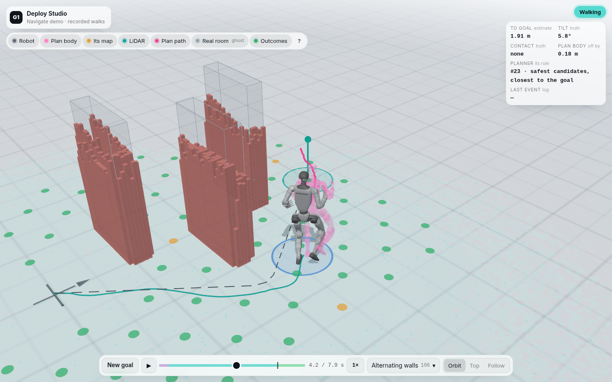
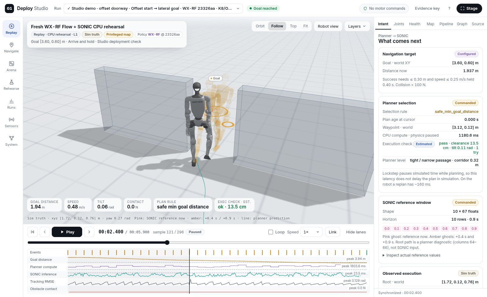
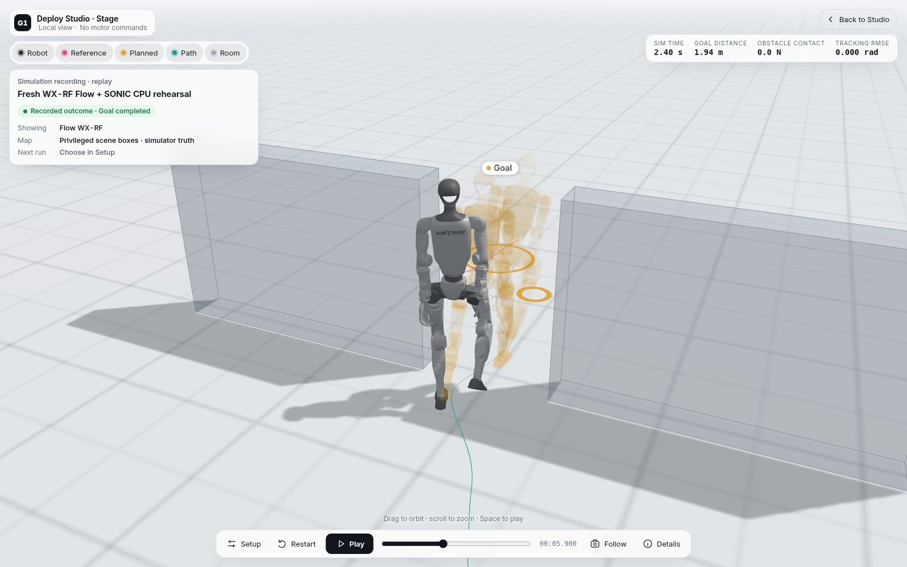

# G1 Deploy Studio

**Try it in your browser: [linjiw.github.io/g1-deploy-studio](https://linjiw.github.io/g1-deploy-studio/)** (full screen: [/demo/](https://linjiw.github.io/g1-deploy-studio/demo/)). Pick a goal on the robot's own LiDAR map, read the checks Studio runs before anything is sent, press Go as the operator does, and watch a recorded, simulated walk of the deploy stack: the frozen Flow student planner, the SONIC tracking policy and node.py's state machine in MuJoCo with a simulated LiDAR, at the robot's deploy settings. Contact and the true final distance are shown with every walk, and the plan body (the pose SONIC is chasing) rides along as a ghost. The site also compares the plan body with the executed body side by side, walks through a robot day with the real pre-Go checklist, and measures the execution gap on [/next/](https://linjiw.github.io/g1-deploy-studio/next/). ([How the site is built](docs/SITE.md).)



A local cockpit for rehearsing Unitree G1 navigation policies before deployment. You can:
- build a navigation arena (walls, overhead beams, start/goal presets);
- run a pinned policy profile in an isolated CPU simulation (Flow planner → SONIC ONNX tracker → MuJoCo);
- watch it live, replay it causally with synchronized sensors, model boundaries and timing, and compare runs;
- **Navigate**: put goals on the robot's own LiDAR map and watch it walk, with a simulated robot that follows the planner node's rules, or with the real robot through the deploy PC (see [docs/NAVIGATE.md](docs/NAVIGATE.md));
- turn a session's map into an arena twin, and print a course build sheet for a real floor.

Recorded SONIC/MuJoCo and C++/DDS rehearsals and ZMQ captures replay through the same timeline.



**No motor commands, ever.** Studio has no DDS participant and no motor-command path: it never publishes `rt/lowcmd`, hand commands or ZMQ `pose`. With the real robot (Navigate's robot link, on the deploy PC, loopback only) it may send the planner node's control socket a goal, only while the robot stands and only after the goal passed its checks, or a stand request, and read the node's status. It never sends Go or quit; the operator starts every walk with `g` on the node console and keeps the remote and the physical E-stop. A simulation result is not hardware readiness, and the robot link has been tested against a protocol fixture only. **Nothing in this repository has run on a robot.**

**Current state, results and open issues:** [docs/STATUS.md](docs/STATUS.md). The documentation index is [docs/README.md](docs/README.md). The narrated 10-minute tour is on the [site](https://linjiw.github.io/g1-deploy-studio/#tour) (recorded before the white redesign).

**What you need.** This repository is Studio: the gateway, the browser app, the simulated robot and robot link adapters, their tests and the site. It contains no robot model, meshes, weights or recordings. Replay works on your own recordings. Rehearsals, Navigate's simulated robot and the robot link read the deploy stack from local checkouts (`g1-student-deploy` with the frozen Flow student bundle and the SONIC release policy, and Flow for the WX profiles), which are not part of this repository. The deploy stack and the navigation policy are pinned in `config/deploy.json` (a private repo and its release), and every machine path comes from `studio/paths.py` (`config/local.json`, ignored).

## Open it

On the development machine the gateway runs as a durable user service on loopback (on a new machine, install it first: [below](#install-on-another-machine) and [docs/INSTALL.md](docs/INSTALL.md)):

```bash
cd g1-deploy-studio
tools/studio_service.sh status        # served commit + unit state
```

Open **http://127.0.0.1:8790/**. The layout adapts from a big screen down to a tablet or a phone (reached through a tunnel: the gateway listens on loopback only). On narrow screens the 3D view comes first, the workspaces move to a tab bar at the bottom, and Navigate's steps (start, pick a goal, send it, Go) sit on the map itself. From another computer, use an SSH tunnel: `ssh -N -L 8790:127.0.0.1:8790 <user>@<host>`, then open `http://localhost:8790/`. See [service and access](docs/SERVICE.md).

**Stage:** choose **Stage** in the top bar, or open [the rehearsal stage](http://127.0.0.1:8790/?workspace=rehearse&focus=1), for one run full screen: the robot, its reference and plan, and the room. It has floating layer pills, one dock and a **Setup** sheet for the existing policy and arena controls. It labels the displayed recording's policy apart from the next run's. See [Stage](docs/STAGE.md).



### Install on another machine

Full guide: [docs/INSTALL.md](docs/INSTALL.md).

```bash
git clone https://github.com/linjiw/g1-deploy-studio ~/code/g1-deploy-studio && cd ~/code/g1-deploy-studio
tools/install.sh                     # Studio: venv, packages, browser files              -> Replay
gh auth login && tools/install.sh --deploy   # deploy stack at the pinned tag + the navigation policy bundle -> Simulation
tools/install.sh --runner --robot-link       # deploy PC only: SONIC runner checkout, config/robot_link.json -> Robot link
.venv/bin/python tools/doctor.py     # read-only check: what is ready, and the fix for what is not
tools/studio_service.sh install      # optional: release worktree + systemd --user unit on 127.0.0.1:8790
```

The privileged Flow WX-RF profile needs a local Flow checkout: `.venv/bin/python tools/build_policy_bundle.py` pins it read-only.

## Workspaces

| Rail | What it is for |
|---|---|
| **Replay** | The 3D twin, fitted to the scene for navigation runs. Pinned transport with tick stepping, plus a timeline whose lanes show events, goal distance, planner compute against the 160 ms deploy replan budget, SONIC inference against the 20 ms tick, tracking RMSE, and obstacle contact against the collision threshold. Cameras: Orbit (auto-recenters during playback), Follow, Top, Fit, and a **Robot view** inset from the LiDAR mount. A HUD shows goal distance, speed, tilt, contact, plan rule and execution check. The inspector has Intent, Joints, Health, Map, Pipeline, Graph and Source tabs. |
| **Arena** | Top-down editor. Draw walls and overhead beams, place pillars, and drag, resize or rotate boxes. Drag the start, its heading tip, and the goal. Templates: corridor, doorway, slalom, overhead beam, U-trap, seeded clutter. Up to 16 named start/goal presets (or seeded random goals and starts), with the server's standing-footprint preflight shown live. Earlier runs on the arena are overlaid. Saved arenas are immutable and hashed; JSON import/export is supported. |
| **Rehearse** | Pick a **policy profile** (preselected: the pinned profile of the block Flow's `research/BEST_MODEL.md` names as adopted, when one is built and available; otherwise the deploy bundle), an arena and a preset, then the success criterion (*arrive & hold* or *reach*), the planner latency (L2) with *measured* or *predictive* anchoring, the **G1 actuator limits** (per hardware revision), duration, seed and K/ODE budget. Run one preset, or a **suite** (every preset × up to 4 seeds) through the single owned worker. The live run attaches to the viewport; when it finishes, its recording opens. |
| **Runs** | Every rehearsal with outcome, policy, criterion, latency, budget, goal distance, contact and planner p95, filterable. A **robustness report** gives Wilson 95% intervals, failure categories and post-hoc Flow-protocol reach. Selected trajectories are overlaid on their arena; CSV and JSON export are available. |
| **Sensors** | What the robot perceives at the cursor: raw and self-filtered ray LiDAR, support and ceiling maps, IMU, joints, contacts. Missing channels stay listed with the reason. Pin up to three views; point clouds overlay the 3D scene. |
| **System** | The deployment chain (sensors → perception → route → Flow → reference → SONIC → PD → robot), drawn per source with orthogonally routed DDS, ZMQ and in-process edges styled as observed, configured or not exercised. It also shows the source-verified **Unitree G1 contract**: the joint table in motor, MuJoCo and IsaacLab order with gains and limits per source, DDS topics, safety thresholds, and 15 recorded source discrepancies, each marked open, mitigated or resolved (the hip limit is resolved by the per-revision actuator profiles). |

Every value carries an evidence chip: MEASURED, SIM-TRUTH, ESTIMATED, COMMANDED, CONFIGURED, OBSERVED, RECORDED or UNAVAILABLE. Unavailable values are never shown as healthy zeros. Press **?** for keyboard shortcuts. A view link restores the run, time, panel, camera, pins, speed and loop.

## Policies

| Profile | Planner | Notes |
|---|---|---|
| `flow-wx-rf-23326aa-s0` | **Flow WX, retrieval-free**: the block `flow/research/BEST_MODEL.md` names as adopted (2026-10-16). Pinned at Flow `23326aa`, config `closed_loop_wxr0_c3.json` (sha `1ffc4069…`), teacher `sk1_s0`, WM-v2 execution check | Flow's own closed-loop callback on MuJoCo. Privileged: plans from the exact boxes, not LiDAR. Default budget K8/ODE6 (evaluated 16/10) |
| `flow-bundle-20261008` | Frozen g1-student-deploy bundle: student-s2-kcsc, the 2026-10-08 bundle student (not Flow's current LiDAR student) | LiDAR-driven sensor route through `sim.lockstep`; the only profile Navigate and the robot run |

Details, caveats and how to add a policy: [docs/POLICIES.md](docs/POLICIES.md). Rehearse shows the Flow research sync status and pins the identity hash into every scenario and run.

## Verify

```bash
.venv/bin/python -m unittest discover -s tests -v       # unit + integration; without the deploy stack its tests skip
python3 tools/check_references.py                        # read-only reference drift check
.venv/bin/python tools/doctor.py                         # read-only machine readiness (docs/INSTALL.md)
.venv/bin/python tools/build_policy_bundle.py --verify-only
STUDIO_URL=http://127.0.0.1:8790 npm run test:browser            # read-only UI acceptance (FK parity, honesty checks, mobile)
STUDIO_URL=http://127.0.0.1:8790 npm run test:browser:forwarded  # same through a Host-preserving tunnel
STUDIO_URL=http://127.0.0.1:8791 npm run test:rehearsal          # launches real bounded CPU runs via the UI
STUDIO_INTEGRATION=1 .venv/bin/python -m unittest tests.test_flow_worker_integration   # real WX worker: flat map + injected failure
.venv/bin/python tools/realtime_preflight.py                     # read-only readiness for the next (L3) step
```

Browser tests need Chromium (`CHROME_PATH`, default `/opt/google/chrome/chrome`). Evidence and screenshots are written under `~/research-data/g1-deploy-studio/evidence/`, outside Git. See [acceptance](docs/ACCEPTANCE.md).

The [2026-10-24 UI/UX review](docs/UIUX_REVIEW_2026-10-24.md) adds failure, cancellation, keyboard, responsive and rendering regressions: `npm run test:browser:edges`, `npm run site:check:edges` and `npm run test:visualization` (set `STUDIO_URL` and/or `SITE_URL` to the local test servers).

## Recordings, capture and export

`config/sessions.json` registers the demonstrated recordings. For other local recordings, create `config/local.json` (ignored) with the same structure and pass `--config config/local.json`. An entry is a recording directory, a Studio `.mcap`, or a single-endpoint `pose` recorder `.jsonl`, plus an optional `environment_path` boxes file. Fresh rehearsals are stored under `~/research-data/g1-deploy-studio/workbench/jobs` and survive restarts.

```bash
# Subscription-only loopback ZMQ capture (never launches a producer or opens DDS):
.venv/bin/python -m studio.recorder --endpoint tcp://127.0.0.1:5557 --topic g1_debug --output /abs/capture.jsonl --duration 10
# Indexed MCAP export of a replay (exclusive creation):
.venv/bin/python -m studio.export /home/linjiw/code/g1-student-deploy/runs/smoke/__start_stand_ /abs/out.mcap \
  --environment /home/linjiw/code/g1-student-deploy/runs/rt/replay-beams2-101/boxes.json
```

## Guides

[Public site](docs/SITE.md) · [Introduction video tooling](tools/video/README.md) · [Robustness campaign](docs/ROBUSTNESS.md) · [Real-time (L3) rehearsal](docs/REALTIME_REHEARSAL.md) · [Service and access](docs/SERVICE.md) · [Policies and the WX adapter](docs/POLICIES.md) · [Arena, rehearsal and runs](docs/WORKBENCH.md) · [Unitree G1 contract](docs/ROBOT_CONTRACT.md) · [Model pipeline](docs/MODEL_PIPELINE.md) · [Sensors](docs/SENSORS.md) · [Interfaces](docs/INTERFACES.md) · [Architecture](docs/ARCHITECTURE.md) · [Acceptance evidence](docs/ACCEPTANCE.md) · [Roadmap](docs/ROADMAP.md) · [Agent rules](AGENTS.md)

## Boundaries

Studio integrates the existing deployment stacks read-only and vendors no weights, meshes, recordings or third-party source. Models and meshes are served from their original local paths. ROS 2, Unitree DDS and ZMQ are distinct transports; a ROS graph never shows the ZMQ edges. The C++/DDS real-time (L3) rehearsal runs the unchanged chain inside a loopback-only user+network+PID namespace (the runner hard-codes DDS domain 0, which cannot leave that namespace). Its launcher, `tools/l3_rehearsal.sh`, is reviewed and ready but is started by an operator ([docs/REALTIME_REHEARSAL.md](docs/REALTIME_REHEARSAL.md)). NVML still fails for new processes, so GPU utilisation is read from another experiment's logger or recorded as unknown. Live robot observation requires separate authorization, a safety review and physical E-stop procedures.

## License

Apache-2.0 ([LICENSE](LICENSE)). Third-party pieces, including the Unitree G1 meshes the public site redistributes (BSD-3-Clause), are listed in [NOTICE](NOTICE). Research software, not affiliated with Unitree Robotics or NVIDIA.
