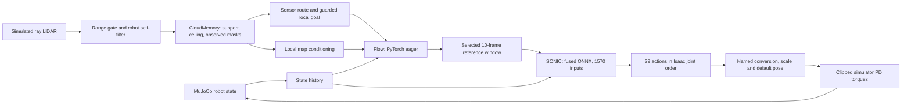

# Inspect the recorded model pipeline

Open a new CPU policy-test replay, select **Health → Inspect pipeline**, and choose a stage. Keep **Map** enabled and attach **Filtered LiDAR** from Sensors. The inspector, articulated robot, reference ghost, perception and Health use the same simulation cursor. **Fit full scene + goal** shows the route context; **Follow** makes joint motion easier to inspect.

The panel explains the actual in-process CPU backend:



This is a recorded computation path. The **Graph** tab separately identifies configured connections and observed traffic; this CPU backend does not exercise ZMQ, DDS or the C++ runner.

## What each stage exposes

| Stage | Actual recorded information | Interpretation |
|---|---|---|
| Sensors | Ray-return acquisition time, map availability, raw/filtered counts, frame, robot pose and observed/unknown masks | Ray returns are simulated; pose and angular velocity are simulator truth. No physical camera or accelerometer image/value is synthesized. |
| Flow | First actual model-forward shapes/statistics, first candidate conditioning map/history/anchor/goal, call count, selected rule, guard and latency | Flow runs in PyTorch, not ONNX. Later ODE calls and rejected trajectories are not fully captured. Its output is normalized ODE velocity, not physical robot velocity. |
| Reference | Selected joint positions/velocities and orientation lookahead, plan age and navigation intent | Cyan ghost is a reference; the predicted path is not guaranteed future motion. Global root translation is a planner diagnostic, not a SONIC observation. |
| SONIC | Exact sampled `float32[1,1570]` input and `[1,29]` action, eight named input blocks and inference latency | This fused ONNX model does not expose latent tokens or hidden activations. The UI supplies no semantic token labels. |
| PD / robot | Named target/pose values, tracking error, actual sampled clipped PD torques | Torques are simulated commands, not measured physical joint torque. Applied values appear only after their physics interval completes. |

Flow's three map channels are support height, lateral input (zeros from this sensor adapter), and overhead clearance. The grids are 31 rows × 61 columns at 0.05 m, in each candidate anchor's heading frame. Heatmaps show numeric ranges and scale each channel separately. Unknown support/ceiling cells receive the source model's input defaults; those defaults **do not establish observed free space**. Use the Map observed/unknown masks to inspect coverage.

The sensor-route uncertainty buffer is a separate planning assumption. New recordings preserve its effective `grow_unknown_m` from the actual native run configuration. It grows observed obstacles into adjacent unknown route cells while preserving known-free cells and the original sensor map. Older recordings without this field show it as unavailable.

## SONIC input and output conventions

| Input block | Offset | Length | Units |
|---|---:|---:|---|
| Reference joint positions | 0 | 290 | rad, Isaac order |
| Reference joint velocities | 290 | 290 | rad/s, Isaac order |
| Reference pelvis orientation, 6D | 580 | 60 | unitless, pelvis-relative |
| Angular velocity history | 640 | 30 | rad/s, body frame |
| Joint position minus default history | 670 | 290 | rad, Isaac order |
| Joint velocity history | 960 | 290 | rad/s, Isaac order |
| Previous action history | 1250 | 290 | unitless, Isaac order |
| Projected gravity history | 1540 | 30 | unitless, body frame |

References contain ten samples spaced 0.1 s apart. History contains ten samples spaced 0.02 s apart, oldest first. The exact named conversion is retained in the recording:

```text
target_mujoco = default_mujoco + action_scale_mujoco * isaac_to_mujoco(action)
```

The contract includes both joint-name lists, the permutation, default pose, action scales, control gains, limits and model/source hashes. These are observed model boundaries, not an exported ONNX layer graph. `tools/check_pipeline_recording.py --replay-onnx` can replay three recorded inputs through the actual CPU model and compare outputs exactly without running another robot trajectory.

## Time, sampling and limits

Flow is captured once per actual replan; SONIC and applied torque samples are decimated to 10 Hz from 50 Hz control. Physics runs at 200 Hz. Each frame indexes the latest causal sample rather than copying all tensors into every frame. There are at most 500 control steps and 500 Flow observations per bounded test. The live snapshot includes only the latest model samples.

Source times are simulation seconds. Receipt times use the host monotonic clock and must not be subtracted from simulation timestamps. Wall inference/planning durations are separate from simulated progress. The CPU run pauses simulation while it computes; it does not demonstrate real-time deadline compliance.

Health's goal evaluator uses completed source-scoring steps: distance, speed and continuous low-speed hold must all satisfy the original task. The whole-run outcome is labelled separately from diagnostics at the cursor. Reaching the radius briefly is not completion.

Capture timing covers tensor copying/statistics, excluding JSON serialization and some PD/scorer copying. Total worker wall time includes those costs. Paused replay draws WebGL only after data, camera or layer changes. Browser disconnects do not control worker lifetime.

This instrumentation is limited to owned CPU tests. Older recordings remain useful for state/reference replay but explicitly lack runtime tensors. Full C++/DDS observation, physical sensor validation and hardware deployment remain separate work; see [live observation](LIVE_OBSERVATION.md).
